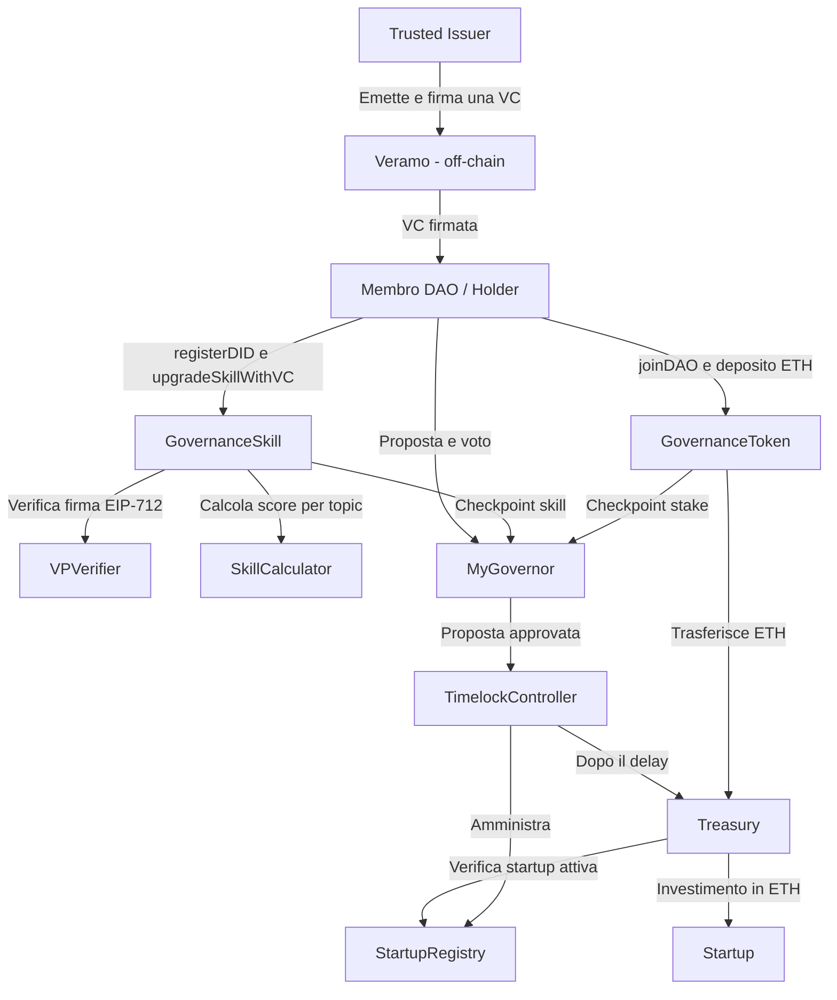

# CompetenceDAO — SAGE

**Una DAO di investimento su Ethereum in cui il potere di voto dipende sia dal capitale depositato sia dalle competenze certificate, valutate in base all'argomento della proposta.**

Il repository contiene il prototipo **CompetenceDAO**, sviluppato per la tesi magistrale *A SSI-based Governance Model for Decentralized Autonomous Organizations*. Il progetto implementa **SAGE** (*Self-sovereign Attestations for Governance with Expertise*), un modello di governance che integra **Self-Sovereign Identity (SSI)**, **Verifiable Credentials (VC)** e smart contract Ethereum.


## Indice

- [Il problema e la soluzione](#il-problema-e-la-soluzione)
- [Funzionalità principali](#funzionalità-principali)
- [Come funziona: esempio pratico](#come-funziona-esempio-pratico)
- [Architettura del sistema](#architettura-del-sistema)
- [Smart contract e responsabilità](#smart-contract-e-responsabilità)
- [Calcolo del voting power](#calcolo-del-voting-power)
- [Competenze, topic e bitmap](#competenze-topic-e-bitmap)
- [Verifiable Credentials e verifica on-chain](#verifiable-credentials-e-verifica-on-chain)
- [Governance ed esecuzione degli investimenti](#governance-ed-esecuzione-degli-investimenti)
- [Evoluzione del prototipo e risultati](#evoluzione-del-prototipo-e-risultati)
- [Tecnologie e struttura del repository](#tecnologie-e-struttura-del-repository)
- [Eseguire la demo in locale](#eseguire-la-demo-in-locale)
- [Test e benchmark](#test-e-benchmark)
- [Sicurezza, assunzioni e limiti](#sicurezza-assunzioni-e-limiti)
- [Riferimenti](#riferimenti)

## Il problema e la soluzione

In molte **Decentralized Autonomous Organizations (DAO)**, le decisioni vengono prese tramite votazioni governate da smart contract. Nei modelli tradizionali, il peso del voto dipende soprattutto dal numero di governance token posseduti o delegati.

Questo meccanismo è semplice, ma presenta un limite: **avere più capitale non significa necessariamente avere le competenze necessarie per valutare una proposta**. Un grande investitore potrebbe influenzare fortemente una decisione su cybersecurity, intelligenza artificiale o blockchain anche senza conoscere quello specifico settore.

SAGE propone un approccio diverso: il voto di ciascun membro è determinato da **due componenti**.

| Componente | Che cosa rappresenta | Come viene gestita |
| --- | --- | --- |
| **Stake** | Partecipazione economica alla DAO | Governance token `COMP` basati su `ERC20Votes` |
| **Skill** | Competenze certificate e rilevanti per la proposta | Score calcolati dalle skill e salvati in checkpoint separati per topic |

La componente skill **non è rappresentata da token trasferibili**: deve rimanere associata alla persona le cui competenze sono state certificate. Inoltre, la stessa competenza può avere un peso diverso a seconda del **topic** della votazione.

**Caso d'uso:** una DAO raccoglie ETH dai propri membri e decide collettivamente se investire in startup registrate. L'esecuzione delle decisioni approvate avviene on-chain tramite un `TimelockController` e un `Treasury`.

## Funzionalità principali

- **Membership:** ingresso nella DAO mediante deposito di ETH, senza approvazione preventiva di una proposta.
- **Stake:** token `COMP`, delega del potere di voto economico e limite di deposito **cumulativo di 100 ETH per indirizzo**.
- **Competenze certificate:** emissione di VC da parte di issuer considerati affidabili (*trusted issuer*) e verifica crittografica direttamente on-chain.
- **Identità decentralizzata:** associazione del wallet del membro a un DID `did:ethr`.
- **Voting power per topic:** combinazione di stake e competenze con pesi configurati al deploy.
- **Snapshot storici:** checkpoint che mantengono il potere di voto corretto anche quando stake e competenze cambiano dopo l'inizio di una votazione.
- **Governance:** proposte associate a uno dei quattro topic, voto, quorum, superquorum e timelock.
- **Investimenti controllati:** fondi conservati nel `Treasury` e trasferibili soltanto verso startup registrate e attive, dopo approvazione della DAO.
- **Valutazione sperimentale:** benchmark gas, confronto fra versioni V0–V3, analisi della bitmap e scenari di distribuzione del potere di voto.

## Come funziona: esempio pratico

Supponiamo che la DAO debba votare un investimento in una startup di **AI & Data**.

- **Alice** ha depositato **100 ETH**, ma possiede soltanto la competenza `blockchain`, poco rilevante per questo topic.
- **Bob** ha depositato **20 ETH** e possiede le competenze certificate `machineLearning` e `dataEngineering`, molto rilevanti per AI & Data.

Con pesi **50% stake / 50% skill**:

| Membro | Score stake | Score skill (AI & Data) | Voting power |
| --- | ---: | ---: | ---: |
| Alice | 100 | 5 | **52,5 VP** |
| Bob | 20 | 75 | **47,5 VP** |

Per Bob, lo score delle competenze è `35 + 30 + 10 = 75`: gli ultimi 10 punti sono un bonus per la combinazione di due competenze complementari.

**Risultato:** pur avendo investito cinque volte meno capitale, Bob possiede quasi lo stesso potere di voto di Alice su quella proposta. Su una proposta relativa a un altro topic, gli stessi membri potrebbero avere pesi differenti.

> Questo è un esempio illustrativo della formula implementata; **SAGE non garantisce che gli esperti prevalgano sempre**. La distribuzione dipende dalle competenze, dagli importi depositati e dai pesi scelti per la DAO.

## Architettura del sistema

Il progetto separa **l'emissione delle credenziali off-chain** dalla loro **verifica e applicazione on-chain**. La DAO non deve fidarsi di un verificatore esterno che comunichi semplicemente un risultato: riceve i dati firmati e ne verifica autonomamente integrità e provenienza.



Il funzionamento si può dividere nei **cinque protocolli** definiti nella tesi:

1. **DAO Membership:** ingresso e registrazione dei membri.
2. **Stake:** depositi, emissione dei token e delega del voto economico.
3. **Competence Certification:** registrazione del DID, verifica delle VC e aggiornamento delle skill.
4. **Governance:** creazione delle proposte, calcolo del voting power e votazioni.
5. **Investment Execution:** esecuzione degli investimenti approvati mediante timelock e treasury.

## Smart contract e responsabilità

I contratti principali si trovano in [`dao/contracts`](dao/contracts).

| Contratto / libreria | Responsabilità |
| --- | --- |
| `GovernanceToken.sol` | Membership, depositi in ETH, token `COMP`, trasferimenti/deleghe consentiti solo tra membri e checkpoint dello stake. Inoltra i fondi al Treasury. |
| `GovernanceSkill.sol` | DID dei membri, trusted issuer, bitmap delle competenze e checkpoint di voting power skill per membro e per topic. |
| `SkillDefinitions.sol` | Definizione dei quattro topic, delle otto skill riconosciute e dei relativi bit. |
| `SkillCalculator.sol` | Calcolo degli score delle skill per ciascun topic, incluse le combinazioni complementari. |
| `VPVerifier.sol` | Ricostruzione del digest EIP-712 e recupero dell'indirizzo Ethereum dell'issuer dalla firma della VC. |
| `MyGovernor.sol` | Estensione della governance OpenZeppelin: proposte multi-topic, voto composito, quorum, superquorum, queue ed execute. |
| `Treasury.sol` | Custodia degli ETH e trasferimenti autorizzati soltanto dal Timelock verso startup valide. |
| `StartupRegistry.sol` | Registro delle startup che possono ricevere investimenti, aggiornabile tramite governance. |
| `MockStartup.sol` | Contratto fittizio che simula una startup destinataria degli investimenti nei test e nella demo. |
| `IGovernanceToken.sol`, `IGovernanceSkill.sol`, `ISkillCalculator.sol` | Interfacce per separare le responsabilità e ridurre l'accoppiamento tra i moduli. |
| `TimelockController` (OpenZeppelin) | Impone un ritardo tra approvazione ed esecuzione delle operazioni governate. |

**Scelte di progettazione importanti:**

- **Stake e competenze separati:** permette di utilizzare `ERC20Votes` senza rendere trasferibile il potere di voto legato alle capacità personali.
- **Interfacce:** `MyGovernor` e `GovernanceSkill` dipendono dalle funzioni necessarie, non dai dettagli interni di ogni modulo.
- **Checkpoints:** consentono di recuperare i valori storici di voto, invece di usare lo stato corrente.
- **Bitmap:** rappresenta le skill con un unico intero e riduce le operazioni di storage.
- **Timelock e ruoli:** separano il processo decisionale dall'effettivo movimento dei fondi.

## Calcolo del voting power

Per ogni membro `account`, topic `topic` e blocco di snapshot `t`:

```text
VP_totale(account, topic, t)
    = VP_stake(account, t) + VP_skill(account, topic, t)

VP_stake = scoreStake × weightStake / 10_000
VP_skill = scoreSkills(topic) × weightSkill / 10_000

scoreStake = min(stakeDeposited / MAX_DEPOSIT, 1) × 100
```

Dove:

- `MAX_DEPOSIT = 100 ETH` nel prototipo;
- `scoreStake` è compreso tra **0 e 100**;
- `scoreSkills` è compreso tra **0 e 100**, e dipende dal topic;
- `weightStake` e `weightSkill` sono espressi in **basis points** e devono sommare a **10.000** (100%).

La configurazione predefinita della demo è **5.000 / 5.000**, cioè 50% per componente. I pesi possono essere modificati al deploy, ma sono **immutabili durante la vita del contratto** per mantenere coerenti gli score e i valori storici. I valori on-chain usano 18 decimali, come i token ERC-20.

### Token, delega e skill: una distinzione essenziale

- Depositando ETH, il membro ottiene `COMP` in proporzione alla componente stake. Con pesi 50/50, **10 ETH generano 5 COMP**.
- La componente token-based usa le regole di `ERC20Votes`: per rendere effettivo il potere di voto economico, il membro deve **delegare**, anche a se stesso.
- Per limitare trasferimenti e deleghe verso soggetti esterni alla DAO, `GovernanceToken` applica vincoli di membership.
- Il voto derivato dalle competenze **non richiede delega e non può essere trasferito**: resta collegato al membro certificato.
- Il limite di 100 ETH considera gli **ETH complessivamente depositati dall'indirizzo**, non il saldo corrente dei token. Trasferire `COMP` non azzera il deposito cumulativo.

### Snapshot e supply per topic

Quando una proposta entra nella fase di voto, dopo il `votingDelay`, viene utilizzato il suo **snapshot**. Il sistema legge:

1. i voti stake storici tramite `ERC20Votes`;
2. i voti skill storici tramite i checkpoint di `GovernanceSkill`, per il topic della proposta.

Di conseguenza, **depositare nuovi ETH o certificare nuove skill dopo lo snapshot non modifica il voto relativo a quella proposta**.

La supply totale utilizzata per la proposta è:

```text
supplyTopic(t) = supplyStake(t) + supplySkill(topic, t)
quorum(t)      = supplyTopic(t) × 20%
superquorum(t) = supplyTopic(t) × 70%
```

Il **quorum** richiede una partecipazione minima: nel prototipo conta `For + Abstain`. Una proposta viene approvata normalmente quando raggiunge il quorum e i voti favorevoli superano quelli contrari. Il **superquorum** permette, nelle condizioni previste dal Governor, di raggiungere lo stato `Succeeded` anche prima della conclusione ordinaria del periodo di voto.

## Competenze, topic e bitmap

### Topic supportati

| ID | Topic |
| ---: | --- |
| `0` | AI & Data |
| `1` | Cloud & Cybersecurity |
| `2` | FinTech & Blockchain |
| `3` | Enterprise Software |

### Skill e rilevanze

Ogni skill contribuisce diversamente ai quattro topic. I valori seguenti sono gli score definiti nel prototipo V3.

| Bit | Skill | AI & Data | Cloud & Cybersecurity | FinTech & Blockchain | Enterprise Software |
| ---: | --- | ---: | ---: | ---: | ---: |
| 0 | `machineLearning` | 35 | 5 | 5 | 15 |
| 1 | `dataEngineering` | 30 | 20 | 15 | 20 |
| 2 | `cyberSecurity` | 15 | 35 | 25 | 20 |
| 3 | `cloudArchitecture` | 15 | 30 | 20 | 30 |
| 4 | `distributedSystems` | 20 | 30 | 25 | 30 |
| 5 | `blockchain` | 5 | 15 | 35 | 15 |
| 6 | `softwareArchitecture` | 15 | 25 | 20 | 35 |
| 7 | `startupFinance` | 15 | 10 | 30 | 25 |

Sono previsti bonus di **+10 punti** per alcune coppie complementari:

| Topic | Coppia di skill |
| --- | --- |
| AI & Data | `machineLearning` + `dataEngineering` |
| Cloud & Cybersecurity | `cyberSecurity` + `cloudArchitecture` |
| FinTech & Blockchain | `blockchain` + `startupFinance` |
| Enterprise Software | `softwareArchitecture` + `cloudArchitecture` |

Lo score per topic è la somma delle rilevanze delle skill certificate e degli eventuali bonus, **con massimo 100**.

### Perché una bitmap?

Le otto skill vengono rappresentate con otto bit di un intero `uint256`. Il bit vale **1** quando il membro possiede la competenza e **0** altrimenti.

```text
Bit (da 7 a 0):        7 6 5 4 3 2 1 0
Bitmap:               0 0 1 0 1 0 0 0
                          |   |
                          |   +-- cloudArchitecture (bit 3)
                          +------ blockchain (bit 5)
```

In questo esempio, `00101000` (binario) rappresenta `cloudArchitecture` e `blockchain`.

Le principali operazioni sono:

```solidity
bitmap |= (1 << skillBit);          // Aggiunge una skill
bool exists = (bitmap & (1 << skillBit)) != 0; // Verifica una skill
```

L'operazione di **OR bit a bit** è idempotente: presentare una skill già registrata non aumenta nuovamente il potere di voto. Quando la bitmap cambia, il contratto ricalcola gli score per **tutti i topic** e aggiorna i relativi checkpoint.

**Trade-off:** la bitmap riduce lo storage, ma richiede un elenco di skill con posizioni stabili e predefinite. Il prototipo operativo ne usa **8**; i benchmark di scalabilità includono configurazioni sperimentali con un numero maggiore di skill per confrontare le strutture dati.

## Verifiable Credentials e verifica on-chain

### Ruoli SSI

- **Issuer:** ente ritenuto affidabile dalla DAO che certifica una o più competenze, firmando una VC con la propria chiave privata.
- **Holder:** membro che riceve la VC e può presentarla alla DAO.
- **Verifier:** smart contract della DAO che verifica la credenziale e applica le skill riconosciute.

Il sistema usa DID basati su indirizzi Ethereum (`did:ethr:0x...`). Il modulo off-chain è realizzato con **Veramo**; la verifica effettiva avviene **on-chain**.

### Quali informazioni contiene una VC?

Le credenziali seguono il modello W3C utilizzato nel prototipo e includono, tra gli altri, i seguenti dati firmati:

```text
VerifiableCredential
├── issuer.id                     # DID dell'issuer
├── issuanceDate                 # data di rilascio
└── credentialSubject
    ├── id                       # DID del membro
    ├── organization             # organizzazione
    ├── unit                     # unità/struttura
    └── skills[]                 # competenze certificate

proof.proofValue                 # firma EIP-712 prodotta dall'issuer
```

Il dominio usato per la firma EIP-712 è:

```text
name:    Universal VC Protocol
version: 1
```

Le implementazioni TypeScript e Solidity condividono **tipi, nomi e ordine dei campi EIP-712**. Il progetto utilizza un provider Veramo personalizzato (`DaoEip712CredentialProvider`) proprio per mantenere questa compatibilità.

### Dalla credenziale alle competenze on-chain

1. Il **trusted issuer** crea e firma off-chain la VC tramite Veramo.
2. Il **membro** entra nella DAO e registra una volta il proprio DID con `registerDID()`. Il DID deve corrispondere al wallet che invia la transazione (`msg.sender`).
3. Il membro presenta la credenziale e la firma tramite `upgradeSkillWithVC()`.
4. `VPVerifier` ricostruisce il **digest EIP-712** dei campi firmati e applica `ECDSA.recover()` per ottenere l'indirizzo del firmatario.
5. `GovernanceSkill` verifica che il **DID dell'issuer** sia coerente con l'indirizzo recuperato, che l'indirizzo sia presente tra i **trusted issuer** e che il **DID del credential subject** coincida con quello registrato dal membro.
6. Se le skill sono riconosciute, il contratto le unisce alla **bitmap**, ricalcola gli score per topic e aggiorna i **checkpoint**.

La verifica della firma garantisce **integrità e origine dei dati firmati**, non la veridicità assoluta delle competenze: quest'ultima dipende dall'affidabilità dell'issuer. Inoltre, **non è necessario che l'issuer rimanga online durante la verifica**.

> **Nota di terminologia:** il contratto si chiama `VPVerifier`, ma il flusso on-chain documentato verifica una **VC firmata dall'issuer**; non implementa un protocollo completo di **Verifiable Presentation (VP)** con selective disclosure.

### Gestione delle chiavi

L'agent Veramo usa un datastore SQLite e un Key Management System (KMS) locale per gestire la chiave dell'issuer. La chiave è cifrata nel datastore mediante un segreto esterno al codice sorgente. Le chiavi private degli **Holder non sono importate nell'agent**: il membro dimostra il controllo del proprio wallet firmando e inviando personalmente le transazioni.

## Governance ed esecuzione degli investimenti

Una proposta deve essere creata tramite **`proposeWithTopic()`**: la funzione standard `propose()` è disabilitata per evitare proposte senza topic.

```text
proposeWithTopic(topic, azione)
    ↓
Pending — attesa del voting delay
    ↓
Active — snapshot e votazione
    ↓
Succeeded oppure Defeated
    ↓ (solo se Succeeded)
queue() — inserimento nel Timelock
    ↓
Attesa del timelock delay
    ↓
execute() — esecuzione dell'azione approvata
```

Parametri usati nella configurazione di riferimento:

| Parametro | Valore |
| --- | ---: |
| Voting delay | 1 blocco |
| Voting period | 50 blocchi |
| Proposal threshold | 0 |
| Quorum | 20% della supply del topic |
| Superquorum | 70% della supply del topic |
| Timelock delay | 3.600 secondi |
| Peso stake / skill | 50% / 50% |

Per investire, la proposta codifica una chiamata a `Treasury.investStartup(startupId, amount)`. Se la DAO approva:

1. il Governor mette l'operazione in coda nel `TimelockController`;
2. scaduto il ritardo, il Timelock chiama il `Treasury`;
3. il Treasury controlla importo, saldo e **presenza e stato attivo** della startup nel `StartupRegistry`;
4. il contratto aggiorna la contabilità dell'investimento e trasferisce gli ETH alla startup.

Il Treasury usa **controllo degli accessi**, `ReentrancyGuard` e il pattern **Checks-Effects-Interactions**. L'aggiunta o disattivazione delle startup e le operazioni amministrative successive al bootstrap passano attraverso la governance.

## Evoluzione del prototipo e risultati

### Versioni sviluppate

| Versione | Idea principale | Motivazione |
| --- | --- | --- |
| **V0** | Un solo `ERC20Votes` rappresenta stake e skill; nessun topic. | Primo modello funzionale, ma rende concettualmente trasferibile anche il voto derivato dalle competenze. |
| **V1** | Stake in `ERC20Votes`, skill in checkpoint separati; nessun topic. | Separa il potere economico da quello personale. |
| **V2** | Introduce topic e score delle skill differenziati, senza bitmap. | Consente votazioni sensibili all'argomento della proposta. |
| **V3** | Mantiene la governance multi-topic e introduce la bitmap. | Riduce il costo della gestione delle competenze. **Versione finale descritta nella tesi.** |

### Benchmark gas

La tesi confronta le quattro versioni utilizzando un **Hardhat Network locale**, uno scenario comune con **10 membri** (5 ETH ciascuno), deleghe, DID, VC con due skill (`cyberSecurity` e `cloudArchitecture`), una proposta di investimento da **10 ETH** e **10 voti (6 For, 4 Against)**.

| Versione | Gas totale: attivazione membri + ciclo di governance |
| --- | ---: |
| V0 | 7.502.524 |
| V1 | 7.612.478 |
| V2 | 9.802.172 |
| **V3** | **9.067.746** |

Nella **V3**:

- attivare 10 membri richiede **7.422.954 gas**;
- un ciclo completo `propose → vote → queue → execute` richiede **1.644.792 gas**;
- una chiamata `upgradeSkillWithVC()` richiede in media **403.614 gas** nello scenario di riferimento: è l'operazione di attivazione individuale più costosa, perché include la verifica della firma e l'aggiornamento degli score per topic.

Il confronto dimostra che la separazione del voto in due componenti e la governance topic-aware introducono un costo, mentre la bitmap permette di recuperarne parte rispetto alla V2.

### Quanto conviene la bitmap?

Nei test di scalabilità sulla **sola gestione delle skill**:

| Numero di skill | Con bitmap | Senza bitmap | Maggior costo senza bitmap |
| ---: | ---: | ---: | ---: |
| 1 | 450.724 gas | 494.712 gas | +9,76% |
| 8 | 474.131 gas | 824.088 gas | +73,81% |
| 16 | 504.279 gas | 1.200.621 gas | +138,09% |
| 32 | 566.919 gas | 1.953.789 gas | +244,63% |
| 64 | 692.311 gas | 3.460.439 gas | +399,84% |

**Attenzione:** questi sono **benchmark di scalabilità della rappresentazione**, non l'elenco delle skill supportate dalla V3 operativa, che ne riconosce otto. Il confronto valuta l'overhead della soluzione senza bitmap rispetto a quella con bitmap, a parità di scenario.

La tesi converte anche i costi in USD usando **parametri storici fissi** (1,03244 Gwei e 2.638,48 USD/ETH) per rendere confrontabili gli esperimenti: **non sono prezzi correnti né costi garantiti su mainnet**.

### Cosa mostrano gli esperimenti sul voting power?

Sono stati analizzati tre scenari:

1. **Variazione dei pesi** fra stake e skill: mostra come cambia il potere decisionale quando la DAO attribuisce più importanza all'una o all'altra componente.
2. **Whale vs minoranza esperta:** nel caso analizzato, con governance esclusivamente economica un grande investitore possiede **59,41%** del voting power; con pesi 50/50 scende a **19,64%**, mentre tre esperti passano complessivamente dal **24,75%** al **55,90%**.
3. **Variazione del topic:** a stake invariato, lo stesso membro riceve più voto sui temi coerenti con le proprie competenze. Un profilo `machineLearning + dataEngineering` con 40 ETH raggiunge **57,5 VP** su AI & Data e **30 VP** su FinTech & Blockchain.

Sono risultati **di scenari sperimentali specifici**, non una dimostrazione che il modello produca sempre decisioni migliori.

## Tecnologie e struttura del repository

### Stack

| Area | Tecnologie |
| --- | --- |
| Blockchain / Smart contract | Ethereum, Solidity `0.8.28`, OpenZeppelin Contracts `5.4` |
| Governance | `Governor`, `ERC20Votes`, `TimelockController` |
| Ambiente di sviluppo | Hardhat `2`, Hardhat Network, Hardhat Ignition |
| Script e test | TypeScript, ethers `6` |
| Identità e credenziali | Veramo `7`, W3C Verifiable Credentials, DID `did:ethr`, EIP-712, ECDSA |
| Persistenza off-chain | SQLite (agent Veramo) |

### Cartelle principali

```text
VCdao/
├── README.md
├── Tesi_Prestifilippo_Consegnata.pdf
├── dao/
│   ├── contracts/                # Smart contract e interfacce Solidity
│   ├── ignition/InvestmentDAO.ts # Modulo di deploy Hardhat Ignition
│   ├── scripts/                  # 8 step della demo end-to-end
│   ├── test/                     # Test funzionali e benchmark
│   ├── hardhat.config.ts
│   └── package.json
├── veramo/
│   ├── providers/                # Provider EIP-712 personalizzato
│   ├── scripts/issue-for-dao.ts  # Emissione VC della demo
│   ├── types/credentials.ts
│   ├── agent.ts
│   ├── .env.example
│   └── package.json
└── experiments data/
    ├── gas mesaures/            # Risultati e report gas
    └── functional VP experiments/# Esperimenti sul voto
```

La struttura sopra riprende quella documentata nel README di partenza; verificare nomi e percorsi dopo eventuali riorganizzazioni del repository.

**File locali generati, da non pubblicare:** `.env`, `veramo/database.sqlite`, credenziali locali, `dao/deployedAddresses.json` e `dao/proposalState.json`. Nel README di partenza sono indicati anche `shared-credentials/` e `veramo/credentials/` per le VC della demo.

## Eseguire la demo in locale

Questa sezione mantiene i comandi riportati nella documentazione del repository. **Non avendo eseguito il codice in questa revisione, i comandi e gli script vanno verificati sul clone effettivo**, in particolare se sono state aggiornate dipendenze o directory.

### Prerequisiti

- Node.js **20.17 o successivo** e npm;
- Git;
- OpenSSL (facoltativo, utile per generare segreti di test).

La demo usa una **rete Ethereum locale Hardhat** configurata con almeno **20 account di test**. Non richiede ETH reali. Gli esempi di shell seguenti sono scritti per Bash; su PowerShell alcuni comandi di ambiente cambiano.

### 1. Installa le dipendenze

Dalla root del repository:

```bash
cd dao
npm install
npx hardhat compile

cd ../veramo
npm install
cp .env.example .env
```

### 2. Configura l'issuer della demo

In `veramo/.env` configura:

```dotenv
DAO_ISSUER_PRIVATE_KEY=0x<chiave-privata-di-test>
DAO_HARDHAT_MNEMONIC="test test test test test test test test test test test junk"
KMS_SECRET_KEY=<segreto-esadecimale-di-32-byte>
DAO_HARDHAT_RPC_URL=http://127.0.0.1:8545
```

Per creare segreti **solo per il laboratorio locale**:

```bash
openssl rand -hex 32  # chiave issuer: anteporre 0x
openssl rand -hex 32  # KMS_SECRET_KEY
```

Calcola l'indirizzo pubblico corrispondente alla chiave issuer (da `veramo/`):

```bash
node -r dotenv/config -e "const { Wallet } = require('ethers'); console.log(new Wallet(process.env.DAO_ISSUER_PRIVATE_KEY).address)"
```

Annota l'indirizzo: serve per impostare `DAO_TRUSTED_ISSUER` durante il deploy.

**Nota per Windows/PowerShell:** usa `Copy-Item .env.example .env` al posto di `cp` e imposta la variabile del deploy così:

```powershell
$env:DAO_TRUSTED_ISSUER = "0x<indirizzo-issuer>"
# Esegui poi: npx hardhat run scripts/01_deploy.ts --network localhost
```

> **Sicurezza:** il mnemonic Hardhat riportato sopra è pubblico e prevedibile. Usalo **soltanto sulla rete locale**. Non committare `.env`, chiavi private o database con informazioni sensibili.

### 3. Avvia Hardhat Network

Apri un primo terminale dalla root del repository:

```bash
cd dao
npx hardhat node
```

Lascia il nodo acceso fino al completamento della demo.

### 4. Deploy, ingresso dei membri e deleghe

In un **secondo terminale**, dalla root del repository:

```bash
cd dao

DAO_TRUSTED_ISSUER=0x<indirizzo-issuer> npx hardhat run scripts/01_deploy.ts --network localhost
npx hardhat run scripts/02_joinMembers.ts --network localhost
npx hardhat run scripts/03_delegateAll.ts --network localhost
```

Il deploy crea e collega i contratti, configura i ruoli del Timelock e il primo trusted issuer e prepara la demo. Se vuoi cambiare i pesi, puoi passare `WEIGHT_SKILL` e `WEIGHT_STAKE` al deploy: devono sommare a **10.000**.

### 5. Emetti le Verifiable Credentials

In un **terzo terminale**, dalla root:

```bash
cd veramo
npm run issue-for-dao
```

Lo script di emissione prepara le VC della demo e le esporta per l'utilizzo da parte degli script Hardhat. Il README di partenza indica **13 VC** nello scenario dimostrativo.

### 6. Esegui il ciclo di governance

Torna al secondo terminale (nella cartella `dao/`):

```bash
npx hardhat run scripts/04_upgradeCompetences.ts --network localhost
npx hardhat run scripts/05_depositTreasury.ts --network localhost
npx hardhat run scripts/06_createProposals.ts --network localhost
npx hardhat run scripts/07_voteOnProposals.ts --network localhost
npx hardhat run scripts/08_executeProposals.ts --network localhost
```

La demo documenta **quattro proposte** con risultati attesi differenti:

| Proposta | Topic | Esito atteso |
| --- | --- | --- |
| A | AI & Data | `Executed` |
| B | Cloud & Cybersecurity | `Executed` |
| C | FinTech & Blockchain | `Defeated` per maggioranza contraria |
| D | Enterprise Software | `Defeated` per mancato quorum |

Gli script producono file di stato locali e simulano il passaggio dall'ingresso dei membri all'esecuzione degli investimenti approvati.

### Deploy alternativo con Hardhat Ignition

Il repository documenta anche il modulo [`dao/ignition/InvestmentDAO.ts`](dao/ignition/InvestmentDAO.ts).

Crea `dao/ignition/parameters.json` con un issuer di test:

```json
{
  "InvestmentDAOModule": {
    "trustedIssuer": "0x<indirizzo-issuer>"
  }
}
```

Poi, da `dao/` e con Hardhat Network avviata:

```bash
npx hardhat ignition deploy ignition/InvestmentDAO.ts \
  --network localhost \
  --parameters ignition/parameters.json
```

**Nota:** il deploy Ignition non sostituisce automaticamente i file di stato consumati dagli otto script della pipeline imperativa.

## Test e benchmark

Dalla cartella `dao/`:

```bash
npm test                 # Test funzionali
npm run test:all         # Suite completa, inclusi gli esperimenti
npm run test:gas         # Benchmark gas
npm run test:voting-power # Esperimenti sulla distribuzione del voto
npm run measure          # Campagne sperimentali
npx hardhat clean        # Rimuove cache e artifact di compilazione
```

I test coprono, tra gli altri, membership, limite di deposito, trasferimenti, deleghe, gestione DID, issuer non fidati, VC alterate, idempotenza delle skill, checkpoint, quorum/superquorum e access control del Treasury.

**Importante:** alcune suite usano VC prodotte da Veramo e salvate localmente. Su un clone pulito potrebbe essere necessario eseguire prima la configurazione della demo e `npm run issue-for-dao`.

Materiale sperimentale documentato:

- [`dao/test/gas/results`](dao/test/gas/results) e [`experiments data/gas mesaures`](experiments%20data/gas%20mesaures);
- [`dao/test/misurazioni/results`](dao/test/misurazioni/results) e [`experiments data/functional VP experiments`](experiments%20data/functional%20VP%20experiments).

## Sicurezza, assunzioni e limiti

### Misure implementate

| Area | Protezione |
| --- | --- |
| Stake | Limite basato sul **deposito cumulativo**, non sui token correntemente posseduti. |
| Membership | Restrizioni sui trasferimenti e sulle deleghe verso indirizzi non membri. |
| Voto storico | Snapshot e checkpoint per evitare che modifiche successive alterino votazioni già iniziate. |
| Identità | Registrazione univoca del DID e controllo della corrispondenza DID–`msg.sender`. |
| Credenziali | Controllo del DID del subject, verifica EIP-712/ECDSA e lista degli issuer autorizzati. |
| Governance | Topic obbligatorio, verifiche sulla supply specifica e decisioni soggette a timelock. |
| Treasury | Esecuzione riservata al Timelock, startup registrate, `nonReentrant` e Checks-Effects-Interactions. |
| Bootstrap | Configurazioni privilegiate iniziali limitate; successiva amministrazione tramite governance. |

Il modello di sicurezza **assume** che gli issuer autorizzati emettano credenziali corrette e proteggano le proprie chiavi, e che il deployer sia affidabile **durante il bootstrap**. Membri ed esterni possono invece essere malevoli.

### Limiti noti

- **Revoca e scadenza delle VC:** non sono gestite automaticamente. Un'eventuale credenziale revocata non comporta la rimozione delle skill già registrate.
- **Privacy:** la blockchain espone `msg.sender`, calldata, eventi, bitmap e informazioni di voto. Memorizzare soltanto l'hash del DID **non assicura anonimato**, perché il DID è derivabile dall'indirizzo e appare anche nella transazione di registrazione.
- **Nessuna selective disclosure o ZKP:** il prototipo trasmette in chiaro il contenuto necessario alla verifica della VC.
- **Sybil:** il cap di 100 ETH è **per indirizzo**, non per persona; non impedisce l'utilizzo di più wallet.
- **Trusted issuer:** la crittografia dimostra chi ha firmato, ma non che l'issuer abbia valutato correttamente una competenza o che la sua chiave non sia compromessa.
- **Tassonomia statica:** topic e bit delle skill sono predefiniti. Cambiarli richiede attenzione alla compatibilità con score e checkpoint storici.
- **Ambito sperimentale:** assenza di frontend e di audit indipendente; nessuna garanzia di sicurezza su una rete pubblica.

### Possibili sviluppi

- Revoca, sospensione e scadenza effettiva delle credenziali con aggiornamento del voting power.
- Selective disclosure e **Zero-Knowledge Proofs** per ridurre i dati esposti.
- Misure anti-Sybil più robuste.
- Evoluzione controllata di topic, skill e criteri di valutazione.
- Audit di sicurezza, test su reti pubbliche di prova e interfaccia utente.

## Riferimenti

- **Tesi magistrale:** *A SSI-based Governance Model for Decentralized Autonomous Organizations*, Università di Pisa, A.A. 2025–2026, Mattia Prestifilippo Colombrino. Relatori: Prof.ssa Laura Ricci e Dott. Calogero Turco. Se inclusa nel repository, consultare [`Tesi_Prestifilippo_Consegnata.pdf`](Tesi_Prestifilippo_Consegnata.pdf).
- [`dao/scripts/command.md`](dao/scripts/command.md): promemoria dei comandi Hardhat, se presente nel repository.
- [`experiments data/functional VP experiments/report.md`](experiments%20data/functional%20VP%20experiments/report.md): report sperimentale sul voting power, se presente.
- [`experiments data/gas mesaures/report.md`](experiments%20data/gas%20mesaures/report.md): report sperimentale dei costi gas, se presente.

---

